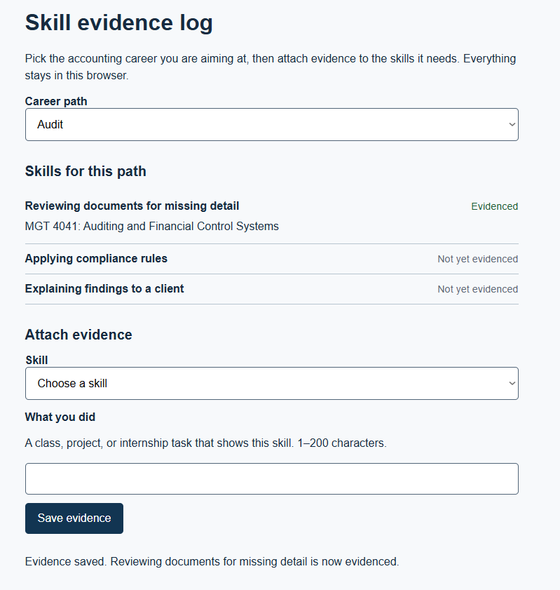

# SkillPath

**One sentence:** SkillPath helps accounting students and recent graduates see which skills their target career path (audit, forensic accounting, IRS/government) needs and attach real evidence from coursework or internships, so they leave school with something concrete to show an employer.

**Deployed:**
- Worker API (Cloudflare): https://mgt3745-hw4.rchoi47.workers.dev/entries
- Page (GitHub Pages): not live yet, planned for the Module 12 deployment

**Status:** partly working. The evidence log (F-03) and export (F-06) work against the deployed Worker and D1, and `npm test` passes 4/4. The page isn't on GitHub Pages yet, and the Worker's CORS origin still points at the old Codespace URL.

**Hours spent:** see [docs/DDR-LOG.md](docs/DDR-LOG.md) for delegated hours; running total to be added.

## See It Work



## Who It Is For

An accounting student or recent graduate aiming at audit, forensic accounting, or a government role. INT-03 (a 2025 accounting graduate, currently unemployed) never figured out which skills her target career needed and graduated with no internship to point to. Career-center lists and generic advice don't connect a specific path to specific skills, and nothing she had tied coursework to evidence an employer can see. Full profiles are in [context/USERS.md](context/USERS.md).

## Run It

```bash
npm install
npm test                 # code evals in evals/, run against the deployed Worker (set API=... to use another)
cd worker && npx wrangler dev
```

## The Record

| Artifact | Link |
|---|---|
| Problem and success measures | [context/PROJECT.md](context/PROJECT.md) |
| Users and jobs | [context/USERS.md](context/USERS.md) |
| Features (EARS rows) | [context/FEATURES.md](context/FEATURES.md) |
| Architecture and ADRs | [context/ARCHITECTURE.md](context/ARCHITECTURE.md), [docs/ADR-001.md](docs/ADR-001.md) |
| Evals, RAT, Stakes, production verdict | [context/EVALS.md](context/EVALS.md) |
| Delegation log | [docs/DDR-LOG.md](docs/DDR-LOG.md) |
| Decision memo | [docs/DECISION-001.md](docs/DECISION-001.md) |
| Real-user feedback | [docs/FEEDBACK.md](docs/FEEDBACK.md) |
| Scaffold audits | [docs/AUDIT.md](docs/AUDIT.md) |
| Deployment notes | [docs/DEPLOY.md](docs/DEPLOY.md) |
| Self-review with Homogenization Check | [docs/SELF-REVIEW.md](docs/SELF-REVIEW.md) |

## AI Use

bolt.new generated the first version of F-06 (the export) in HW5, and I reviewed and fixed it before keeping it. Google AI Studio was tried for the same feature but errored before producing code. The details and verification are in [docs/DDR-LOG.md](docs/DDR-LOG.md).
