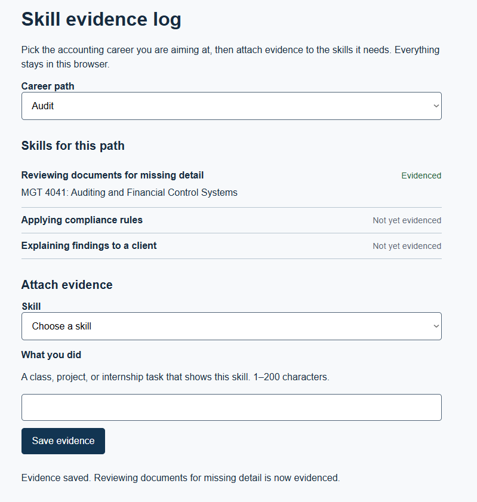

# SkillPath

**One sentence:** SkillPath helps accounting students and recent graduates see which skills their target career path (audit, forensic accounting, IRS/government) needs and attach real evidence from coursework or internships, so they leave school with something concrete to show an employer.

**Deployed:**
- Worker API (Cloudflare): https://mgt3745-hw4.rchoi47.workers.dev/entries
- Page (GitHub Pages): https://reginachoi.github.io/mgt3745-final-ReginaChoi/ (deployed 2026-11-17, [docs/DEPLOY.md](docs/DEPLOY.md))

**Status:** deployed, first real-user saves in. The skill list (F-01), evidence log (F-03) and export (F-06) run on GitHub Pages against the deployed Worker and D1. Since the 2026-11-17 deploy, D1 holds saves in three separate windows on 2026-11-18 ET (rows 31 to 34, 0 flagged by the personal-data guardrail); the observation write-ups are in [docs/FEEDBACK.md](docs/FEEDBACK.md). Known bug: the evidence form can double-submit (rows 32 and 33), see [docs/DDR-007.md](docs/DDR-007.md).

**Hours spent:** 31.25 recorded so far: HW3 14 (mgt3745-hw3 README), HW4 12 (mgt3745-hw4 README), HW5 5.25 (tool run plus review and fixes, [docs/DDR-001.md](docs/DDR-001.md)). HW1, HW2 and HW7 weren't tracked, so the real total is higher.

## See It Work



## Who It Is For

An accounting student or recent graduate aiming at audit, forensic accounting, or a government role. INT-03 (a 2025 accounting graduate, currently unemployed) never figured out which skills her target career needed and graduated with no internship to point to. Career-center lists and generic advice don't connect a specific path to specific skills, and nothing she had tied coursework to evidence an employer can see. Full profiles are in [context/USERS.md](context/USERS.md).

## Run It

```bash
npm install
npm test                 # code evals in evals/, run against the deployed Worker (set API=... to use another)
cd worker && npx wrangler dev
```

## Rollback Runbook

Status as of 2026-11-17: **written, not yet tried.** The data half was tested once: on 2026-11-12 a D1 export was restored locally with 12/12 rows (docs/DDR-003.md). A Worker rollback hasn't been run yet; I'll run it once before the first user session and add a dated note to docs/AUDIT.md.

1. **Back up the data first:** `cd worker && npx wrangler d1 export mgt3745-entries --remote --output=backup.sql` (backup.sql is git-ignored).
2. **Roll the Worker back:** `npx wrangler deployments list`, then `npx wrangler rollback <version-id>` for the last good version.
3. **Roll the page back:** `git revert <bad-commit>` and push to `main`; GitHub Pages redeploys from it.
4. **Remove a bad write:** `npx wrangler d1 execute mgt3745-entries --remote --command "DELETE FROM evidence WHERE id = <id>"`, or rebuild the table from backup.sql.
5. **Check:** `npm test` passes 4/4 against the deployed Worker, and `GET /entries` matches the export.

## The Record

Milestone check-in items 1 to 8 are numbered in the first column.

| # | Artifact | Link |
|---|---|---|
| 1 | Problem, reframe, temporary-resolution stance, success measures | [context/PROJECT.md](context/PROJECT.md) |
| 2 | Users and jobs | [context/USERS.md](context/USERS.md) |
| 3 | Features (Kano, EARS rows, exclusions) | [context/FEATURES.md](context/FEATURES.md) |
| 4 | ADR-001 (Gate with weights) | [docs/ADR-001.md](docs/ADR-001.md) |
| 4 | Architecture diagram and Trust Boundary | [context/ARCHITECTURE.md](context/ARCHITECTURE.md) |
| 5 | RAT and Prediction Stake | [context/EVALS.md](context/EVALS.md) |
| 6 | First DDR (bolt.new, F-06) and the delegation log | [docs/DDR-001.md](docs/DDR-001.md) (2026-10-01), [docs/DDR-LOG.md](docs/DDR-LOG.md) |
| 7 | Context Scaffold Audit 1 | [docs/AUDIT.md](docs/AUDIT.md) |
| 8 | Sourcing Audit (HW7) and the tools ledger | [docs/SOURCING-AUDIT.md](docs/SOURCING-AUDIT.md), [context/TOOLS.md](context/TOOLS.md) |
| | Decision memo (criteria committed 2026-11-17, before deployment) | [docs/DECISION-001.md](docs/DECISION-001.md) |
| | Real-user feedback (Nov 19) | [docs/FEEDBACK.md](docs/FEEDBACK.md) |
| | Deployment notes | [docs/DEPLOY.md](docs/DEPLOY.md) |
| | Decision-metric queries | [evals/queries/](evals/queries/README.md) |
| | Self-review with Homogenization Check (Dec 14) | [docs/SELF-REVIEW.md](docs/SELF-REVIEW.md) |

**Dating note.** The final-project RAT and Prediction Stake in context/EVALS.md were first committed on 2026-11-12. That's after F-01, F-03 and F-06 were built (HW3 to HW5, carried in by commit `3ca78d7`) but before the deployment build and the real-user sessions they predict. The HW5 Stake for the F-06 delegation was committed before that build (2026-10-01 in the HW5 repo).

## AI Use

Claude Code (Claude Opus 5.5) helped run the HW7 Sourcing Audit and port HW5 into this repo, logged in [docs/DDR-003.md](docs/DDR-003.md). bolt.new generated the first version of F-06 (the export) in HW5, and I reviewed and fixed it before keeping it ([docs/DDR-001.md](docs/DDR-001.md)). GitHub Copilot helped write the HW4 Worker and D1 backend ([docs/DDR-002.md](docs/DDR-002.md)). Google AI Studio was tried for F-06 but errored before producing code. In HW6 it did build a feature for the team problem, but none of that code is in SkillPath. The details and verification are in [docs/DDR-LOG.md](docs/DDR-LOG.md).
