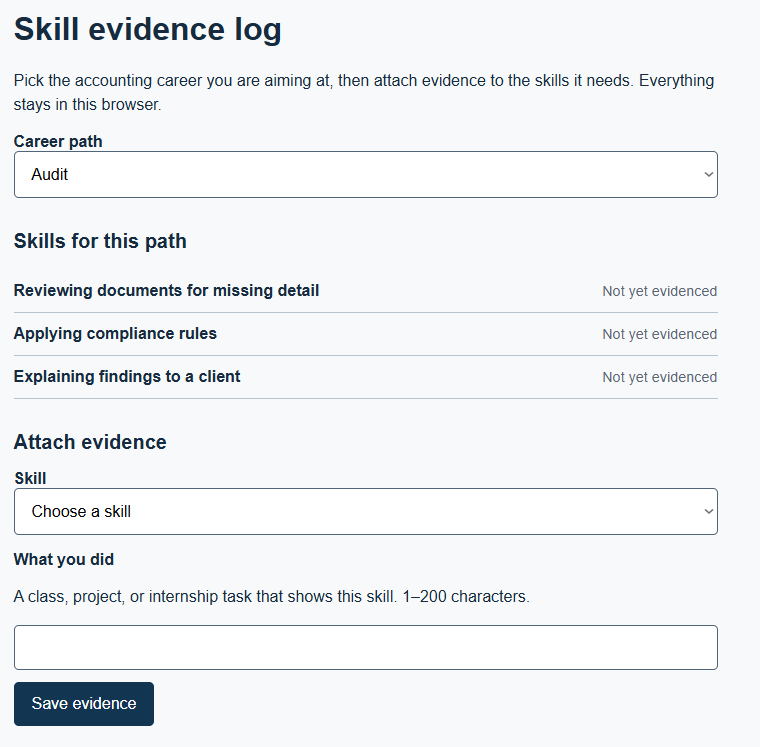
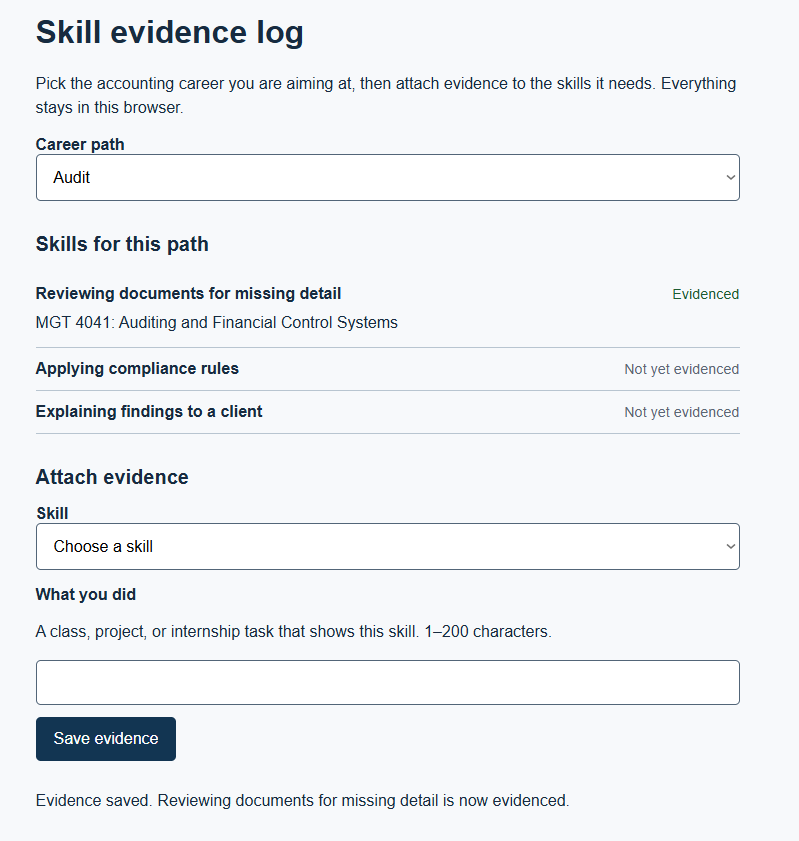
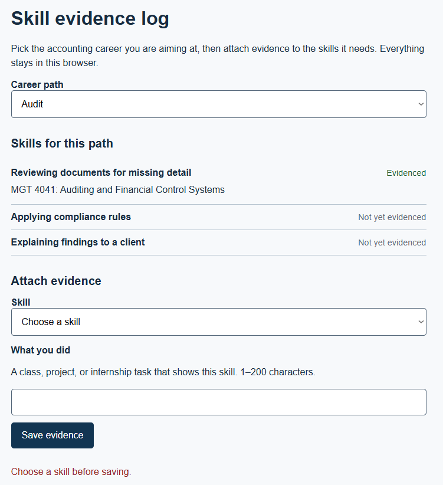
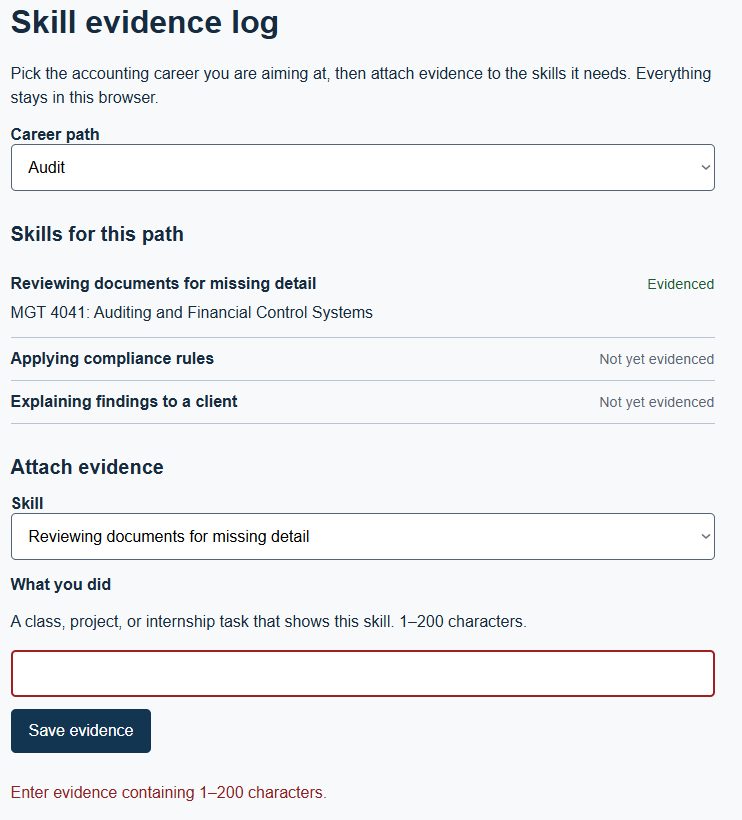
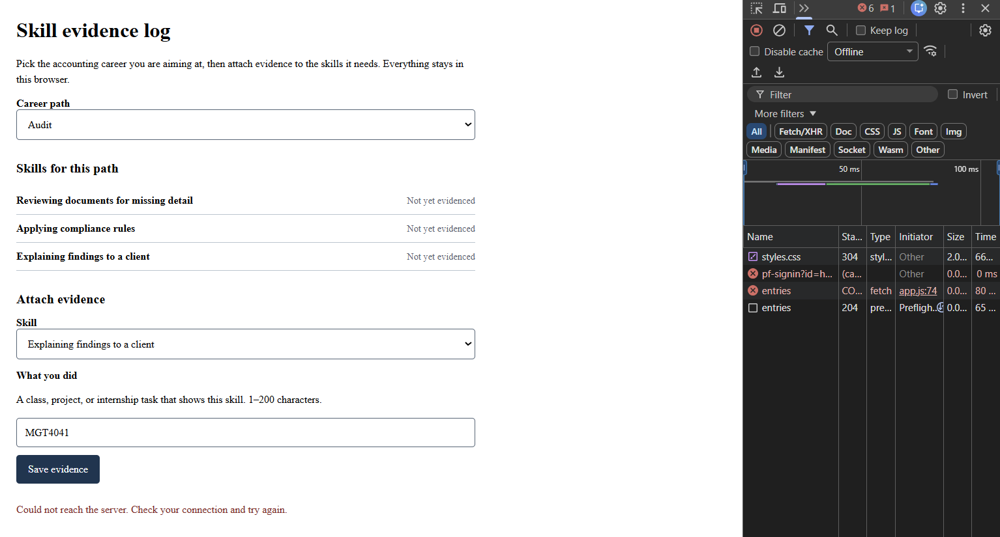
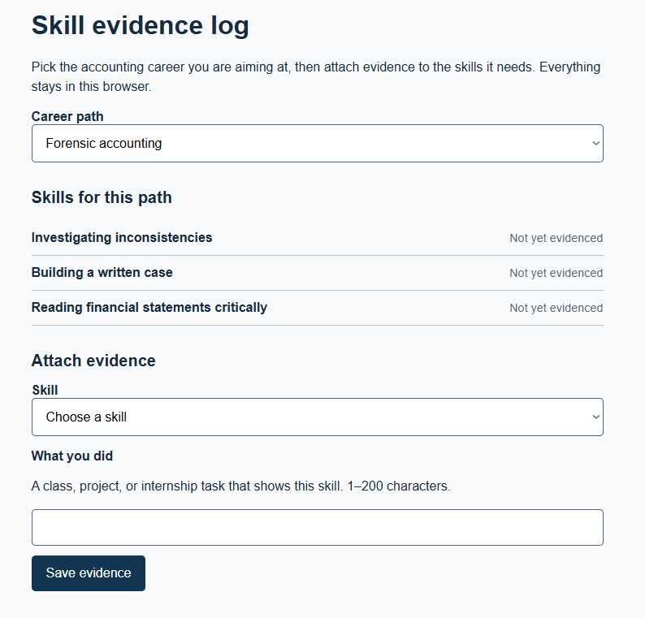
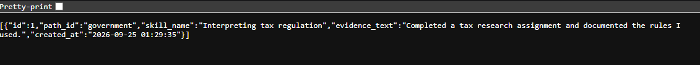
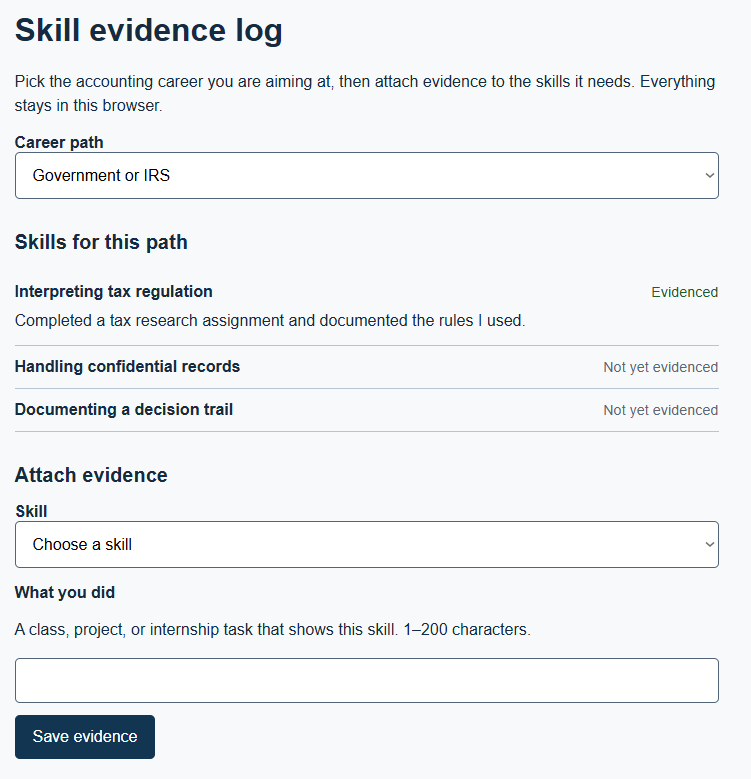

# EVALS.md

Final-project evals. The RAT and Prediction Stake below were committed on 2026-11-12, **after** the HW3 to HW5 build of F-01, F-03 and F-06 and **before** the next build: the Module 12 deployment (GitHub Pages, the CORS change) and the first real-user sessions they predict. The HW5 record is kept unchanged at the bottom.

## Riskiest Assumption (RAT)
An accounting student who sees the skill list for their chosen path will **attach at least one piece of real evidence on their own**, without me prompting them. If that's false, F-03 (the evidence log) and F-06 (the export) are pointless, and SkillPath is just a list of skills. Why it's the riskiest: INT-03 said she never tracked skills and never thought to (context/USERS.md). The part she called useful was *seeing* the skills, not recording proof.

Test: the first 3 real users, observed in the Module 12 sessions. Confirmed if at least 2 of 3 save evidence unprompted. Refuted if 0 or 1 does.

## Prediction Stake (committed before the deployment build and the first user session)
<!-- Never edit the prediction text; add resolutions below it. -->
- **Tight:** Fewer than 2 of the first 3 real users will save a piece of evidence within 5 minutes of opening the page without help. (I'm betting against my own leading-indicator target, because of how lukewarm INT-03 was: "Yes, because hopefully I'd get a job.")
- **Loose:** Users will spend more of their session reading and switching between skill lists (F-01) than typing evidence (F-03), because seeing the skills is what INT-03 said she'd use. Resolves from my timed observation notes in docs/FEEDBACK.md.
- **Open:** What do real users type as evidence: course names, projects, jobs, or nothing? Resolves from the D1 export after 3 sessions.

## Code evals
| Row | Test file | Result | Date |
|---|---|---|---|
| F-03 Ubiquitous (GET returns entries in creation order) | evals/worker.test.js | Pass | 2026-11-12 |
| F-03 AC-8 / AC-3 (POST {} rejected with 400 and a reason) | evals/worker.test.js | Pass | 2026-11-12 |
| F-03 AC-2 (valid POST is stored and shows up in GET) | evals/worker.test.js | Pass | 2026-11-12 |
| F-06 AC-10 (saved evidence is available to the export) | evals/worker.test.js | Pass | 2026-11-12 |

`npm test`: tests 4, pass 4, fail 0 (against https://mgt3745-hw4.rchoi47.workers.dev).

## Judgment evals
| Item | Grader 1 | Grader 2 | Agree? |
|---|---|---|---|
| F-06 AC-11 and AC-12 messages, 12 questions (HW5, [mgt3745-hw5 docs/JUDGMENT.md](https://github.com/ReginaChoi/mgt3745-hw5/blob/main/docs/JUDGMENT.md)) | Me | Second grader (HW5) | 12 of 12 |
| Real-user sessions (Module 12) | Me | to be named before the sessions | pending |

## Error log (most frequent first)
| Failure | Frequency | First seen | Fixed in |
|---|---|---|---|
| AI Studio returned "Request contains an invalid argument" with no output | 1 | 2026-10-01 (HW5) | Not fixable on my side; AI Studio is Trial now (SOURCING-AUDIT.md) |
| bolt.new's npm test script didn't target the test file | 1 | 2026-10-01 (HW5) | Fixed by hand in HW5 |
| `npm test` threw if `API` wasn't set | 1 | 2026-11-12 | Defaults to the deployed Worker (commit 3ca78d7) |

## RAT verdict
Untested as of 2026-11-12. Resolved here after the first 3 user sessions; the RAT above stays unchanged.

## Production verdict
After Module 12: what real users did against the outcome, leading indicator, and guardrail in context/PROJECT.md.

---

## HW5 record (kept unchanged)

The verification table from HW3, grown up. Five sections, in this order.

The first two are written and committed BEFORE any tool sees the spec.

### 1. RAT statement

The riskiest assumption in delegating F-06 is that bolt.new can add an exportable skill summary without breaking the existing evidence-log behavior or bypassing the current application structure.

### 2. Prediction Stake (before build, 2026-10-01 17:10 EST)

<!-- At least one of each. Never edit the prediction text; add resolutions below it. -->

- **Tight:** At least 3 of 4 EARS rows will pass on the tool's first output.

  - Resolved October 1, 2026: 4 of 4.

- **Loose:** bolt.new will follow STYLE.md tokens better than AI Studio.

  - Resolved October 2, 2026: Not determinable because AI Studio did not produce an implementation; it returned an invalid-argument error before generating output.

- **Open:** The tool will introduce a dependency I did not ask for. Resolves when I read package.json.

  - Resolved October 1, 2026: No new dependency was introduced.

### 3. Success criteria

| EARS row (feature) | Checked by | Where |
|---|---|---|
| AC-9: WHEN a student chooses to export the skill summary, THE SYSTEM SHALL generate a summary containing the selected career path and the student's skills and evidence statuses. | test + human | `npm test`; rendered export output |
| AC-10: WHEN the student has attached evidence to skills, THE SYSTEM SHALL include the evidence text for those evidenced skills in the exported summary. | test + human | `npm test`; rendered export output |
| AC-11: IF the student has not selected a career path, THEN THE SYSTEM SHALL prevent the export and tell the student what is missing. | judgment + human | `docs/JUDGMENT.md`; rendered page |
| AC-12: IF the student requests an export when there are no skills to summarize, THEN THE SYSTEM SHALL tell the student that there is nothing to export. | judgment + human | `docs/JUDGMENT.md`; rendered page |

### 4. Error-analysis log

<!-- Every failure observed, a few words each, counted, sorted by count. -->

| Failure (a few words) | Count | Source | Category |
|---|---:|---|---|
| AI Studio returned an invalid-argument error before producing an implementation | 1 | AI Studio | cannot verify |
| Original npm test script did not target the test file correctly and was corrected | 1 | Bolt | tooling |

### 5. Evals

- **Code:** `npm test` with `API=https://mgt3745-hw4.rchoi47.workers.dev`; 4 tests, 4 passing. [README.md](https://github.com/ReginaChoi/mgt3745-hw5/blob/main/docs/README.md)

- **Judgment:** `docs/JUDGMENT.md`, 12 questions, two graders, agreement 100%.

- **AI Studio comparison:** No implementation was generated. AI Studio returned `Request contains an invalid argument` even for a minimal test request, so no AI Studio code was available for the seven-question implementation comparison.

### Verification table (carried from HW4)

| Criterion | Steps and input | Expected result | Observed result | Status | Evidence / commit |
|---|---|---|---|---|---|
| AC-1 | Load the deployed page. Select each career path in the dropdown in turn. | The skill list updates to that path's skills, visibly within 2 seconds. | Selected each career path on the deployed page. The skill list updated to the corresponding skills within 2 seconds. | PASS |  |
| AC-2 | Select a path, select a skill, type valid evidence text (1 to 200 characters), click Save evidence. | The skill's status changes from "Not yet evidenced" to "Evidenced" and the entered text appears under it. | Saved valid evidence on the deployed page. The skill changed to "Evidenced," and the entered text appeared under the skill. | PASS |  |
| AC-3 | Leave the skill dropdown on "Choose a skill" and try to save; then select a skill, leave evidence empty, and try to save. | An error message appears in both cases; the typed text (if any) stays in the input. | Both invalid save attempts displayed an error message. Previously entered text remained in the input. | PASS |   |
| AC-4 | Select a path and skill, enter valid evidence, make the server unavailable, and attempt to save. | If the save fails, the entered text remains on screen and the page shows an error identifying the failure. | Set DevTools network to Offline and attempted to save evidence. The entered text remained on the page and an error was shown. | PASS |  |
| AC-5 | Load a path with no evidence yet attached to any of its skills. | Every skill on that path reads "Not yet evidenced." | Loaded a path with no saved evidence. All skills displayed "Not yet evidenced." | PASS |  |
| AC-6 | Inspect the rendered page and the response from GET /entries after saving evidence. | Only evidence that was actually saved is present; nothing is scoped to another student because there is no login yet, but no client-side comparison feature displays anyone else's rows either. | The deployed page displayed the saved evidence, and GET /entries returned the saved evidence. No other rows were displayed by the client. | PASS |   |
| AC-7 | Inspect the application for an inactive career-path state and attempt to preserve evidence under an inactive path. | Evidence logged under an inactive career path should remain preserved. | No UI exists to mark a career path inactive, so this criterion cannot be exercised through the current application. | NOT IMPLEMENTED | No UI exists for inactive paths; see Scope and ADR-001 |
